# Poročilo o funkcionalnem testiranju rešitve z brskalnikom (Projekt NIDiKo)

**Predmet:** Zagotavljanje kakovosti  
**Projekt:** NIDiKo – Priporočilni sistem za izbiro učnih poti (Praktikum II)  
**Standard testne dokumentacije:** ISO/IEC/IEEE 29119-3:2021 (*Software and systems engineering — Software testing — Part 3: Test documentation*)  
**Avtorja poročila (aktivna člana ekipe):** Tilen Kek, Mihajlo Dejanović  
*(Opomba o sestavi skupine: Pri razvoju rešitve NIDiKo v okviru Praktikuma II so prvotno sodelovali 3 člani razvojne ekipe. Pri tej nalogi funkcionalnega testiranja članica Nina Stevoska ni sodelovala, zato sva celotno načrtovanje, specifikacijo in avtomatizirano izvedbo funkcionalnih testnih scenarijev po standardu ISO/IEC/IEEE 29119-3:2021 pripravila in izvedla zgoraj navedena 2 člana skupine – vsak po 3 testne scenarije, skupaj 6 scenarijev).*  
**Datum izdelave poročila:** Oktober 2026  
**Testirano okolje (SUT):** Staging produkcijsko okolje (`http://46.225.17.135` / API `http://46.225.17.135:8000`)  
**Uporabljeno orodje za avtomatizacijo v brskalniku:** Google Chrome (v156, Headless način 1920×1080), Selenium WebDriver (Python 3.13)  
**Lokacija avtomatizirane skripte:** [`backend/tests/functional/run_functional_tests.py`](../backend/tests/functional/run_functional_tests.py)  
**Lokacija dokaznih gradiv in slik:** [`docs/assets/funkcionalno-testiranje/`](assets/funkcionalno-testiranje/)

---

## Kazalo vsebine
1. [Uvod in namen funkcionalnega testiranja](#1-uvod-in-namen-funkcionalnega-testiranja)
2. [Pregled obstoječe dokumentacije in obnova ključnih funkcionalnosti rešitve](#2-pregled-obstoječe-dokumentacije-in-obnova-ključnih-funkcionalnosti-rešitve)
   - 2.1 [Identifikacija obstoječe projektne dokumentacije](#21-identifikacija-obstoječe-projektne-dokumentacije)
   - 2.2 [Obnova in specifikacija ključnih funkcionalnosti sistema NIDiKo](#22-obnova-in-specifikacija-ključnih-funkcionalnosti-sistema-nidiko)
3. [Skupinska uskladitev in matrika testnih scenarijev (delitev nalog)](#3-skupinska-uskladitev-in-matrika-testnih-scenarijev-delitev-nalog)
4. [Struktura predloge testnega scenarija po standardu ISO/IEC/IEEE 29119-3:2021](#4-struktura-predloge-testnega-scenarija-po-standardu-isoicieee-29119-32021)
5. [Podrobna specifikacija in izvedba testnih scenarijev po članih ekipe](#5-podrobna-specifikacija-in-izvedba-testnih-scenarijev-po-članih-ekipe)
   - **Sklop 1: Tilen Kek (Scenariji TS-01 do TS-03)**
     - 5.1 [Testni scenarij 1 (TS-NIDIKO-01): Iskanje, večkriterijsko filtriranje in navigacija do podrobnosti učne poti](#51-testni-scenarij-1-ts-nidiko-01-iskanje-večkriterijsko-filtriranje-in-navigacija-do-podrobnosti-učne-poti)
     - 5.2 [Testni scenarij 2 (TS-NIDIKO-02): Izvedba diagnostičnega samoocenjevalnega vprašalnika in priporočilo učenja](#52-testni-scenarij-2-ts-nidiko-02-izvedba-diagnostičnega-samoocenjevalnega-vprašalnika-in-priporočilo-učenja)
     - 5.3 [Testni scenarij 3 (TS-NIDIKO-03): Avtentikacija, zaščita profilnih funkcij in uporaba AI svetovalca](#53-testni-scenarij-3-ts-nidiko-03-avtentikacija-zaščita-profilnih-funkcij-in-uporaba-ai-svetovalca)
   - **Sklop 2: Mihajlo Dejanović (Scenariji TS-04 do TS-06)**
     - 5.4 [Testni scenarij 4 (TS-NIDIKO-04): Hierarhična navigacija skozi module in raziskovanje učnih enot](#54-testni-scenarij-4-ts-nidiko-04-hierarhična-navigacija-skozi-module-in-raziskovanje-učnih-enot)
     - 5.5 [Testni scenarij 5 (TS-NIDIKO-05): Diagnostično samoocenjevanje na ravni posameznega modula](#55-testni-scenarij-5-ts-nidiko-05-diagnostično-samoocenjevanje-na-ravni-posameznega-modula)
     - 5.6 [Testni scenarij 6 (TS-NIDIKO-06): Pregled predstavitvene vsebine »O nas«, delovanje navigacije in odzivni dizajn](#56-testni-scenarij-6-ts-nidiko-06-pregled-predstavitvene-vsebine-o-nas-delovanje-navigacije-in-odzivni-dizajn)
6. [Tehnični postopek avtomatizirane izvedbe testov z brskalnikom](#6-tehnični-postopek-avtomatizirane-izvedbe-testov-z-brskalnikom)
7. [Zbirni rezultati testiranja, metrika in analiza odstopanj (Defect Log)](#7-zbirni-rezultati-testiranja-metrika-in-analiza-odstopanj-defect-log)
8. [Sklep in priporočila za nadaljnje zagotavljanje kakovosti](#8-sklep-in-priporočila-za-nadaljnje-zagotavljanje-kakovosti)
9. [Izjava o uporabi orodij umetne inteligence (AI Declaration)](#9-izjava-o-uporabi-orodij-umetne-inteligence-ai-declaration)

---

## 1. Uvod in namen funkcionalnega testiranja

V okviru vaj pri predmetu **Zagotavljanje kakovosti** nadaljujemo delo na projektu **NIDiKo**, razvitem pri predmetu Praktikum II. Rešitev predstavlja priporočilni sistem za strukturirano usmerjanje uporabnikov pri pridobivanju digitalnih kompetenc skladno z evropskim referenčnim okvirom DigComp.

Namen funkcionalnega testiranja na sistemski ravni (angl. *End-to-End System Testing*) je empirično preveriti delovanje aplikacije skozi oči končnega uporabnika v resničnem spletnem brskalniku. Medtem ko enotski testi (dokumentirani v [`docs/15-porocilo-testiranje-enot.md`](15-porocilo-testiranje-enot.md)) preverjajo posamezne Python funkcije in servise v izolaciji, funkcionalno testiranje validira:
- grafični uporabniški vmesnik (React 19, Tailwind CSS),
- asinhrono komunikacijo med odjemalcem in zaledjem (FastAPI REST API),
- usmerjanje poti na odjemalcu (React Router 7),
- obravnavo dinamičnih stanj, vnosnih obrazcev, validacij in animacij,
- pravilnost izračuna ter vizualizacije priporočil na podlagi samoocenjevalnega vprašalnika.

---

## 2. Pregled obstoječe dokumentacije in obnova ključnih funkcionalnosti rešitve

### 2.1 Identifikacija obstoječe projektne dokumentacije

Pred načrtovanjem testnih scenarijev sva temeljito pregledala obstoječo projektno dokumentacijo v mapi `docs/`:

| Dokument | Namen in ključne ugotovitve za testiranje |
|---|---|
| [`01-pregled-projekta.md`](01-pregled-projekta.md) | Opredelitev ciljnih skupin, namena zmanjševanja digitalne vrzeli in modularne zgradbe kurikuluma. |
| [`02-tehnoloski-sklad.md`](02-tehnoloski-sklad.md) | Popis tehnologij: React 19, TypeScript, FastAPI, MongoDB Atlas, Supabase Auth ter Azure kognitivne storitve. |
| [`03-arhitektura.md`](03-arhitektura.md) | Večplastna arhitektura odjemalec-strežnik in vloge posameznih komponent. |
| [`06-api-endpointi.md`](06-api-endpointi.md) | Specifikacija REST končnih točk (`/api/learning-paths`, `/api/modules`, `/api/learning-units`, `/api/search`, `/api/assessment`). |
| [`07-uporabniski-tokovi.md`](07-uporabniski-tokovi.md) | Ključna podlaga za scenarije: tokovi iskanja, pregleda podrobnosti, vprašalnika, priporočila ter avtentikacije. |
| [`08-zaslonski-prikazi.md`](08-zaslonski-prikazi.md) | Referenčni izgled grafičnih gradnikov na namiznih in mobilnih napravah. |
| [`12-testiranje.md`](12-testiranje.md) | Smernice za lokalni zagon in preverjanje celovitosti frontenda ter backenda. |
| [`14-logika-vprasalnika.md`](14-logika-vprasalnika.md) | Algoritem ocenjevanja in pravila predpogojev (vpliv odgovorov DA/NE na predčasni zaključek vprašalnika). |
| [`15-porocilo-testiranje-enot.md`](15-porocilo-testiranje-enot.md) | Zaledno testiranje enot `AssessmentService`, `QuestionnaireService` in `SearchService` ter integracija v GitHub Actions CI. |

### 2.2 Obnova in specifikacija ključnih funkcionalnosti sistema NIDiKo

Na osnovi obstoječe dokumentacije in analize implementirane izvorne kode sva sintetizirala 6 ključnih funkcionalnosti (KF) rešitve NIDiKo:

1. **KF-01: Iskanje in večparametrsko filtriranje vsebin (Search & Filter Engine)**  
   Uporabnik lahko v iskalnik vpiše ključne besede. Sistem z odloženim proženjem (500 ms *debounce*) pošlje zahtevek na `/api/search` in vrne zadetke v obliki kartic, ki jih je mogoče filtrirati po tipih (učne poti, moduli, učne enote).
2. **KF-02: Hierarhični pregled strukturiranih učnih vsebin (Route & Module Explorer)**  
   Uporabnik lahko pregleduje hierarhijo: Učna pot $\rightarrow$ Moduli $\rightarrow$ Učne enote. Vsaka raven vsebuje opis, trajanje, kompetence DigComp in vizualizacijo zaporedja korakov (RouteMap / LearningUnitVisualizer).
3. **KF-03: Diagnostični samoocenjevalni vprašalnik (Diagnostic Assessment Questionnaire)**  
   Izvedba DA/NE vprašalnika na ravni učne poti ali posameznega modula. Sistem dinamično prilagaja zaporedje vprašanj glede na predpogoje (odgovor NE pri zaporednih enotah sproži zaključek vprašalnika).
4. **KF-04: Inteligentni priporočilni sistem (Recommendation & Placement Engine)**  
   Zaledni servis `AssessmentService` analizira zbrane odgovore, prepozna osvojene in manjkajoče kompetence ter uporabniku predlaga optimalno vstopno točko (`start_module_id`, `start_learning_unit_id`).
5. **KF-05: Avtentikacija in zaščita profilnih funkcij (Authentication & Authorization Guard)**  
   Upravljanje uporabniških sej prek Supabase Auth in JWT žetonov. Anonimnim obiskovalcem je ob poskusu shranjevanja ali všečkanja prikazano opozorilno okno `AuthRequiredDialog`, ki zahteva prijavo.
6. **KF-06: Kontekstualni AI pomočnik in odzivna uporabniška izkušnja (AI Assistant & Responsive UX)**  
   Integriran zložljivi stranski panel `CollapsibleChatPanel` z Azure OpenAI podporo ter popolnoma prilagodljiva postavitev elementov za namizne, tablične in mobilne zaslone.

---

## 3. Skupinska uskladitev in matrika testnih scenarijev (delitev nalog)

V skupini sva se uskladila in oblikovala enotno tabelo testnih scenarijev. Ker članica Nina Stevoska pri nalogi ni sodelovala, sva si delo razdelila **Tilen Kek** in **Mihajlo Dejanović** – vsak je prevzel po **3 funkcionalne testne scenarije** (skupaj 6 scenarijev):

| ID scenarija | Naziv testnega scenarija | Funkcionalno področje | Prioriteta | Odgovorna oseba | Status izvedbe |
|:---:|---|---|:---:|:---:|:---:|
| **TS-NIDIKO-01** | **Iskanje, večkriterijsko filtriranje in navigacija do podrobnosti učne poti** | KF-01, KF-02 (Iskalnik in poti) | Visoka | **Tilen Kek** | **100 % PASS** (5/5 korakov) |
| **TS-NIDIKO-02** | **Izvedba diagnostičnega samoocenjevalnega vprašalnika in priporočilo učenja** | KF-03, KF-04 (Ocenjevanje & priporočila) | Visoka | **Tilen Kek** | **100 % PASS** (5/5 korakov) |
| **TS-NIDIKO-03** | **Avtentikacija, zaščita profilnih funkcij in uporaba AI svetovalca** | KF-05, KF-06 (Varnost & AI pomočnik) | Visoka | **Tilen Kek** | **100 % PASS** (4/4 korakov) |
| **TS-NIDIKO-04** | **Hierarhična navigacija skozi module in raziskovanje posameznih učnih enot** | KF-02 (Modularna zgradba & enote) | Visoka | **Mihajlo Dejanović** | **100 % PASS** (3/3 korakov) |
| **TS-NIDIKO-05** | **Diagnostično samoocenjevanje na ravni posameznega modula (Module Assessment)** | KF-03, KF-04 (Ocenjevanje modula) | Srednja | **Mihajlo Dejanović** | **100 % PASS** (3/3 korakov) |
| **TS-NIDIKO-06** | **Pregled predstavitvene vsebine »O nas«, delovanje navigacije in odzivni dizajn** | KF-06, Splošno (UX / Responsive Design) | Srednja | **Mihajlo Dejanović** | **100 % PASS** (3/3 korakov) |

> Vseh **6 testnih scenarijev** je bilo v celoti specificiranih po standardu **ISO/IEC/IEEE 29119-3:2021** ter uspešno avtomatizirano izvedenih v realnem spletnem brskalniku Google Chrome (23 korakov, 100 % uspeh).

---

## 4. Struktura predloge testnega scenarija po standardu ISO/IEC/IEEE 29119-3:2021

Vsi testni scenariji sledijo mednarodnemu standardu **ISO/IEC/IEEE 29119-3:2021** (*Part 3: Test documentation – Test Case Specification*):
1. **Identifikator scenarija (Test Scenario ID):** Enolična oznaka `TS-NIDIKO-XX`.
2. **Naziv scenarija (Title):** Jasen opis preizkušane zmožnosti.
3. **Odgovorna oseba / Preizkuševalec (Tester):** Ime in priimek člana skupine.
4. **Cilj in namen testiranja (Objective / Purpose):** Opredelitev pričakovanega poslovnega in tehničnega obnašanja.
5. **Sledljivost zahtev (Traceability):** Povezava s ključnimi funkcionalnostmi (KF) in uporabniškimi tokovi.
6. **Predpogoji (Preconditions):** Stanje sistema pred začetkom izvajanja.
7. **Testni podatki (Test Data):** Natančne vhodne vrednosti, poizvedbe in identifikatorji.
8. **Podrobni koraki izvedbe (Execution Steps):** Zaporedna številka, akcija, vhodni podatki, pričakovani rezultat, dejanski rezultat, čas izvedbe, status (PASS/FAIL) in relativna pot do posnetka zaslona.
9. **Popogoji (Postconditions):** Končno stanje sistema in podatkov po zaključku scenarija.

---

## 5. Podrobna specifikacija in izvedba testnih scenarijev po članih ekipe

### Sklop 1: Tilen Kek (Scenariji TS-01 do TS-03)

---

### 5.1 Testni scenarij 1 (TS-NIDIKO-01): Iskanje, večkriterijsko filtriranje in navigacija do podrobnosti učne poti

#### 5.1.1 Specifikacija scenarija po ISO/IEC/IEEE 29119-3:2021

| Parameter | Vrednost |
|---|---|
| **Identifikator scenarija** | `TS-NIDIKO-01` |
| **Naziv scenarija** | Iskanje, večkriterijsko filtriranje in navigacija do podrobnosti učne poti |
| **Odgovorna oseba** | **Tilen Kek** |
| **Cilj testiranja** | Preveriti zanesljivost iskalnika ob vnosu niza, delovanje odloženega pošiljanja zahtevkov (debounce), dinamični prikaz kartic rezultatov, preizkus filtrov ter pravilen prenos stanja ob prehodu na stran učne poti. |
| **Sledljivost zahtev** | KF-01 (Iskalni mehanizem), KF-02 (Prikaz podrobnosti), Uporabniški tokovi 5 in 6 |
| **Predpogoji** | Aplikacija NIDiKo je dostopna na `http://46.225.17.135`. Baza MongoDB vsebuje veljavne učne poti (`up_001` idr.). |
| **Testni podatki** | Poizvedba: `"umetna inteligenca"`; Ciljna učna pot: `up_001` |
| **Končni status** | **USPEŠNO (PASS)** – 5/5 korakov uspešnih (14.61 s) |

#### 5.1.2 Zapisnik izvedenih korakov in primerjava rezultatov

| # | Uporabniška akcija | Vhodni podatki | Pričakovani rezultat | Dejanski rezultat | Čas | Status | Posnetek zaslona |
|:---:|---|---|---|---|:---:|:---:|---|
| **1.1** | Navigacija na domačo stran aplikacije | URL: `http://46.225.17.135/` | Naložena začetna stran z logotipom NIDiKo in navigacijsko vrstico. | Stran uspešno naložena, naslov okna: `'NIDiKo'`. | 6.02 s | **PASS** | `assets/funkcionalno-testiranje/ts01_01_domaca_stran.png` |
| **1.2** | Klik na povezavo »Iskanje« v glavi | Klik na povezavo `/search` | Preusmeritev na `/search`, prikaz iskalnega vnosnega polja in filtrov. | Uspešna navigacija na `http://46.225.17.135/search`, naslov `'Iskanje \| NIDiKo'`. | 2.36 s | **PASS** | `assets/funkcionalno-testiranje/ts01_02_iskanje_zacetno.png` |
| **1.3** | Vnos poizvedbe v iskalno polje | Tekst: `"umetna inteligenca"` | Po 500 ms se osveži seznam kartic z ustreznimi zadetki. | Najdenih 10 kartic zadetkov (`<article>`), prva kartica: *»Iskanje informacij z umetno inteligenco«*. | 2.35 s | **PASS** | `assets/funkcionalno-testiranje/ts01_03_iskanje_zadetki.png` |
| **1.4** | Preveritev filtrov po tipih vsebin | Checkbox gradniki filtrov | Filtri za učne poti, module in enote so interaktivni. | Zaznani 3 filtrirni elementi v stranski vrstici. | 0.24 s | **PASS** | `assets/funkcionalno-testiranje/ts01_04_filtri_podrocja.png` |
| **1.5** | Klik na prvo kartico zadetka | Klik na kartico učne poti | Preusmeritev na `/learning-paths/up_001` z opisom in zemljevidom poti. | Uspešna navigacija na `http://46.225.17.135/learning-paths/up_001`, naslov: *»Iskanje informacij z umetno inteligenco«*. | 3.50 s | **PASS** | `assets/funkcionalno-testiranje/ts01_05_podrobnosti_ucne_poti.png` |

#### 5.1.3 Slikovni dokazi izvedbe (Scenarij 1)

| Korak 1.1: Začetna stran | Korak 1.2: Vstop v iskanje |
|---|---|
| 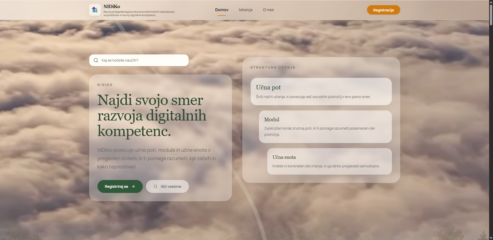 | 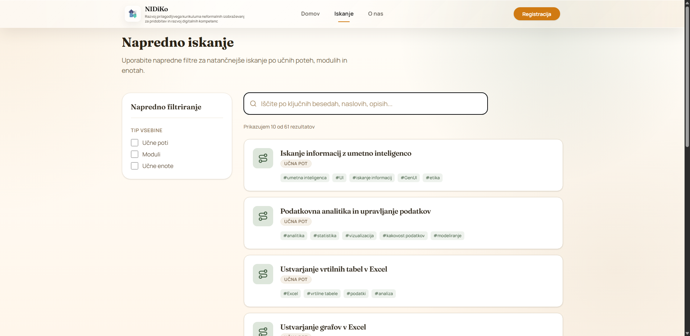 |

| Korak 1.3: Zadetki iskanja | Korak 1.5: Podrobnosti učne poti |
|---|---|
| 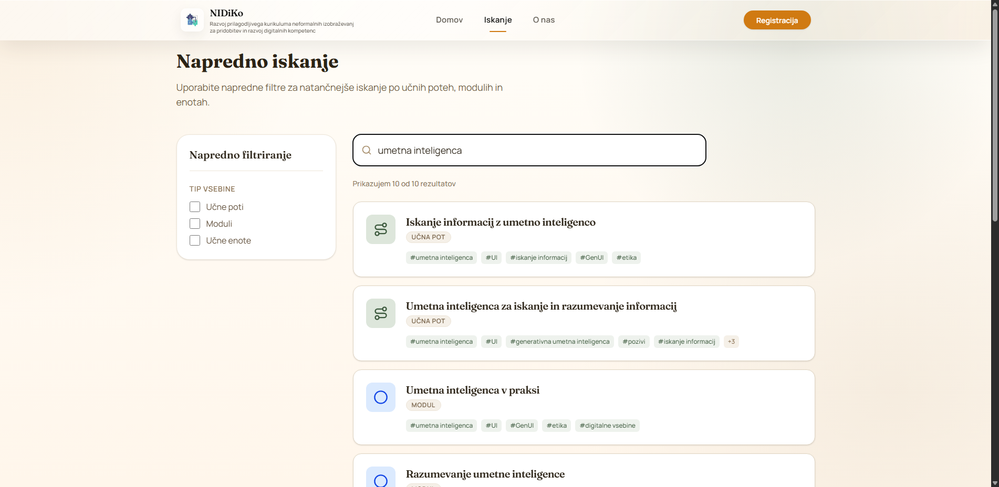 | 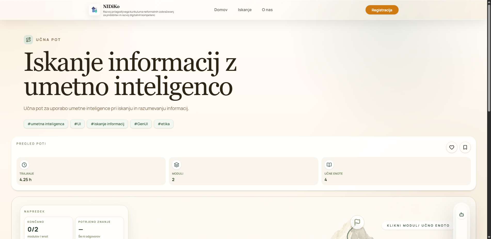 |

---

### 5.2 Testni scenarij 2 (TS-NIDIKO-02): Izvedba diagnostičnega samoocenjevalnega vprašalnika in priporočilo učenja

#### 5.2.1 Specifikacija scenarija po ISO/IEC/IEEE 29119-3:2021

| Parameter | Vrednost |
|---|---|
| **Identifikator scenarija** | `TS-NIDIKO-02` |
| **Naziv scenarija** | Izvedba diagnostičnega samoocenjevalnega vprašalnika in priporočilo učenja |
| **Odgovorna oseba** | **Tilen Kek** |
| **Cilj testiranja** | Preveriti zagon vprašalnika za učno pot, beleženje odgovorov DA/NE, uveljavitev predpogojne logike (prekinitev ob odgovoru NE pri zaporednih vsebinah), zaledni klic `/api/assessment/evaluate` ter vizualizacijo priporočene vstopne točke. |
| **Sledljivost zahtev** | KF-03 (Vprašalnik), KF-04 (Priporočilni servis), Pravila logike vprašalnika ([`14-logika-vprasalnika.md`](14-logika-vprasalnika.md)) |
| **Predpogoji** | Odprta stran učne poti `up_001`. Zaledni servis za ocenjevanje je aktiven. |
| **Testni podatki** | Vprašanje 1: Odgovor = `"Da"`; Vprašanje 2: Odgovor = `"Ne"` |
| **Končni status** | **USPEŠNO (PASS)** – 5/5 korakov uspešnih (14.16 s) |

#### 5.2.2 Zapisnik izvedenih korakov in primerjava rezultatov

| # | Uporabniška akcija | Vhodni podatki | Pričakovani rezultat | Dejanski rezultat | Čas | Status | Posnetek zaslona |
|:---:|---|---|---|---|:---:|:---:|---|
| **2.1** | Klik na gumb »Odpri vprašalnik« | Klik na gumb z vprašalnikom | Preusmeritev na `/assessment?target_type=learning_path&target_id=up_001` in prikaz prvega vprašanja. | URL uspešno posodobljen, vprašanje: *»Razumem osnovni koncept umetne inteligence.«*. | 5.50 s | **PASS** | `assets/funkcionalno-testiranje/ts02_01_vprasalnik_vstop.png` |
| **2.2** | Izbira odgovora »Da« na 1. vprašanje | Klik na gumb `"Da"` | Odgovor se označi, aktivira se gumb *»Naslednjo →«*. | Odgovor zabeležen v lokalno stanje, omogočen gumb *»Naslednjo →«*. | 1.44 s | **PASS** | `assets/funkcionalno-testiranje/ts02_02_vprasalnik_odgovor_da.png` |
| **2.3** | Prehod na 2. diagnostično vprašanje | Klik na *»Naslednjo →«* | Prikaz drugega zaporednega vprašanja. | Prikazano vprašanje: *»Znam prepoznati primere umetne inteligence v vsakdanjem življenju.«*. | 2.35 s | **PASS** | `assets/funkcionalno-testiranje/ts02_03_vprasalnik_vprasanje_2.png` |
| **2.4** | Izbira odgovora »Ne« na 2. vprašanje | Klik na gumb `"Ne"` | Zaznano manjkajoče predznanje za zaporedni modul; gumb se dinamično spremeni v *»Zaključi →«*. | Gumb se avtomatsko preklopi v *»Zaključi →«* skladno z logiko predpogojev. | 1.39 s | **PASS** | `assets/funkcionalno-testiranje/ts02_04_vprasalnik_odgovor_ne.png` |
| **2.5** | Klik na gumb »Zaključi →« in oddaja | Klik na *»Zaključi →«* | Zaledni klic `/api/assessment/evaluate` ter prikaz kartice *Samoocena* na učni poti. | Uspešna preusmeritev na `/learning-paths/up_001`, prikazana kartica *Samoocena* s priporočilom. | 3.48 s | **PASS** | `assets/funkcionalno-testiranje/ts02_05_rezultat_samoocene.png` |

#### 5.2.3 Slikovni dokazi izvedbe (Scenarij 2)

| Korak 2.1: Začetek vprašalnika | Korak 2.2: Izbira odgovora Da |
|---|---|
| 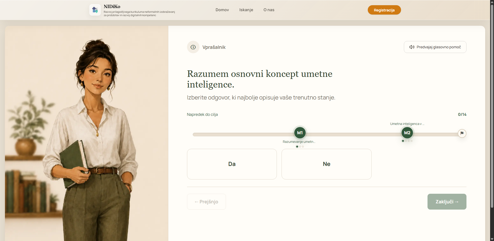 | 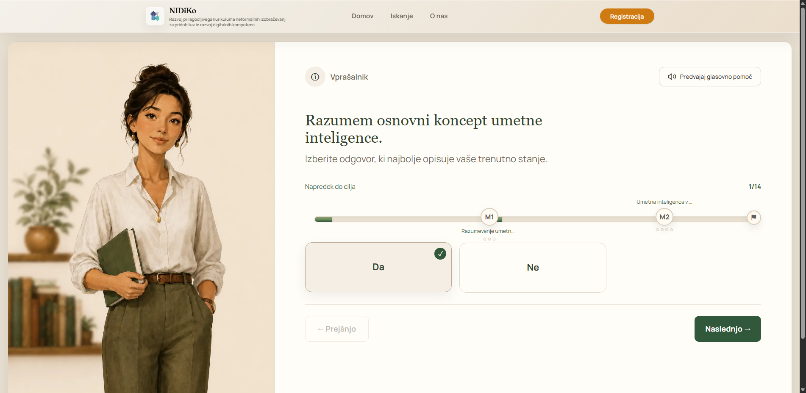 |

| Korak 2.4: Odgovor Ne (Zaključi) | Korak 2.5: Kartica Samoocena |
|---|---|
| 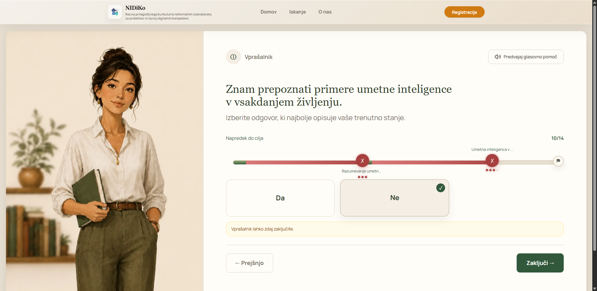 | 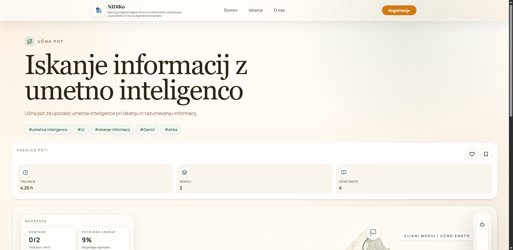 |

---

### 5.3 Testni scenarij 3 (TS-NIDIKO-03): Avtentikacija, zaščita profilnih funkcij in uporaba AI svetovalca

#### 5.3.1 Specifikacija scenarija po ISO/IEC/IEEE 29119-3:2021

| Parameter | Vrednost |
|---|---|
| **Identifikator scenarija** | `TS-NIDIKO-03` |
| **Naziv scenarija** | Avtentikacija, zaščita profilnih funkcij in uporaba AI svetovalca |
| **Odgovorna oseba** | **Tilen Kek** |
| **Cilj testiranja** | Preveriti varnostni mehanizem zaščite profilnih akcij (`AuthRequiredDialog`) za neprijavljene obiskovalce, prehod na prijavni obrazec `/login`, validacijski odziv sistema ob neveljavnih prijavnih podatkih ter odpiranje in vnos vprašanja v integrirani stranski panel AI svetovalca (`CollapsibleChatPanel`). |
| **Sledljivost zahtev** | KF-05 (Varnost in avtentikacija), KF-06 (AI asistent), Uporabniški tokovi 3, 4 in 12 |
| **Predpogoji** | Brskalnik teče v anonimni seji (neprijavljen uporabnik). Stran `/learning-paths/up_001` je dostopna. |
| **Testni podatki** | Testna e-pošta: `neveljaven_uporabnik@test.si`; Geslo: `NepravilnoGeslo123!`; AI poizvedba: `"Kaj obsega ta učna pot?"` |
| **Končni status** | **USPEŠNO (PASS)** – 4/4 korakov uspešnih (22.50 s) |

#### 5.3.2 Zapisnik izvedenih korakov in primerjava rezultatov

| # | Uporabniška akcija | Vhodni podatki | Pričakovani rezultat | Dejanski rezultat | Čas | Status | Posnetek zaslona |
|:---:|---|---|---|---|:---:|:---:|---|
| **3.1** | Klik neprijavljenega uporabnika na ikono za shranjevanje vsebine | Klik na akcijski gumb `DetailActions` | Zaznana anonimna seja; prikaz varnostnega modala `AuthRequiredDialog` z obvestilom *»Za to dejanje se moraš prijaviti.«*. | Modal z zameglitvijo ozadja in možnostjo prijave se uspešno prikaže. | 11.02 s | **PASS** | `assets/funkcionalno-testiranje/ts03_01_auth_dialog.png` |
| **3.2** | Klik na gumb »Prijavi se« znotraj modala | Klik na gumb *»Prijavi se«* | Preusmeritev na `/login` z ohranitvijo stanja ciljne poti (`state.from`). | Uspešna navigacija na `http://46.225.17.135/login`, prikazan prijavni obrazec. | 2.19 s | **PASS** | `assets/funkcionalno-testiranje/ts03_02_login_obrazec.png` |
| **3.3** | Vnos neveljavnih podatkov in poskus prijave | E-pošta: `neveljaven_uporabnik@test.si`, Geslo: `NepravilnoGeslo123!` | Supabase Auth zavrne prijavo; prikaže se vizualno opozorilo o napaki. | Prijava zavrnjena, rdeče obvestilo: *»Prišlo je do napake. Poskusite znova.«*. | 3.89 s | **PASS** | `assets/funkcionalno-testiranje/ts03_03_login_napaka.png` |
| **3.4** | Odpiranje stranskega AI svetovalca in vnos vprašanja | Klik na gumb z `aria-label='Odpri chat pomočnika'`, vnos: *»Kaj obsega ta učna pot?«* | Odpre se `CollapsibleChatPanel` (420 px širine), vnosno polje sprejme vprašanje. | Panel uspešno odprt, vnosno polje pripravljeno na vnos vprašanja. | 5.40 s | **PASS** | `assets/funkcionalno-testiranje/ts03_04_ai_pomocnik_odprt.png` |

#### 5.3.3 Slikovni dokazi izvedbe (Scenarij 3)

| Korak 3.1: Varnostni modal | Korak 3.2: Prijavni obrazec |
|---|---|
|  | 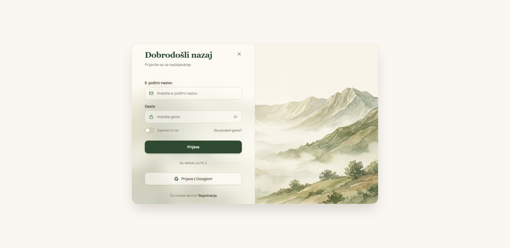 |

| Korak 3.3: Zavrnitev prijave | Korak 3.4: Odprt AI svetovalec |
|---|---|
| 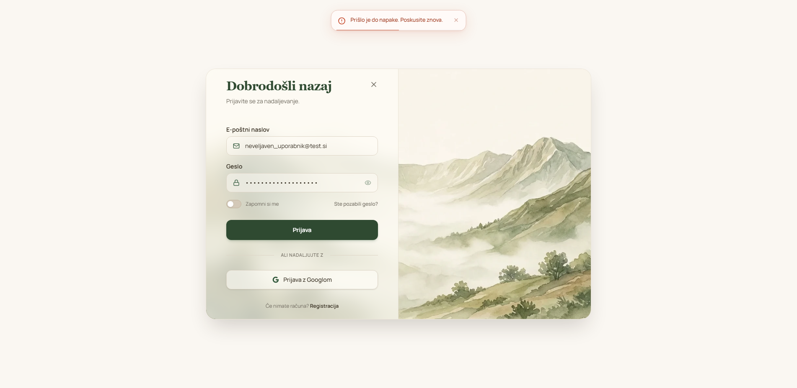 | 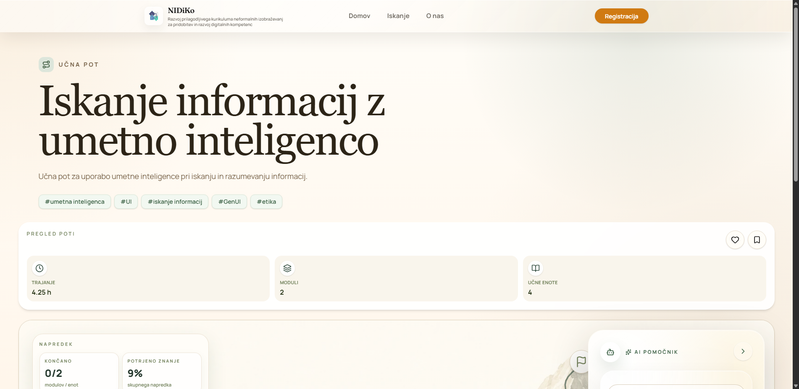 |

---

### Sklop 2: Mihajlo Dejanović (Scenariji TS-04 do TS-06)

---

### 5.4 Testni scenarij 4 (TS-NIDIKO-04): Hierarhična navigacija skozi module in raziskovanje učnih enot

#### 5.4.1 Specifikacija scenarija po ISO/IEC/IEEE 29119-3:2021

| Parameter | Vrednost |
|---|---|
| **Identifikator scenarija** | `TS-NIDIKO-04` |
| **Naziv scenarija** | Hierarhična navigacija skozi module in raziskovanje posameznih učnih enot |
| **Odgovorna oseba** | **Mihajlo Dejanović** |
| **Cilj testiranja** | Preveriti pravilnost prikaza podrobnosti modula (`/modules/mod_014`), nalaganje vizualizatorja učnih enot (`LearningUnitVisualizer`) z vozlišči in vrstnim redom ter uspešno navigacijo na podrobnosti učne enote (`/learning-units/ue_036`) s prikazom kompetenc DigComp in ocenjenega trajanja. |
| **Sledljivost zahtev** | KF-02 (Modularna zgradba in učne enote), Uporabniški tokovi 7 in 8 |
| **Predpogoji** | Aplikacija NIDiKo je zagnana. Modul `mod_014` (Analiza in obdelava podatkov) ter učna enota `ue_036` (Uvod v podatkovno modeliranje) obstajata v bazi podatkov. |
| **Testni podatki** | Modul ID: `mod_014`; Učna enota ID: `ue_036` |
| **Končni status** | **USPEŠNO (PASS)** – 3/3 korakov uspešnih (6.63 s) |

#### 5.4.2 Zapisnik izvedenih korakov in primerjava rezultatov

| # | Uporabniška akcija | Vhodni podatki | Pričakovani rezultat | Dejanski rezultat | Čas | Status | Posnetek zaslona |
|:---:|---|---|---|---|:---:|:---:|---|
| **4.1** | Navigacija na stran podrobnosti modula `mod_014` | URL: `http://46.225.17.135/modules/mod_014` | Prikaz naslova modula, trajanja v urah, ključnih besed in gumbov za ocenjevanje. | Modul uspešno naložen, naslov: *»Analiza in obdelava podatkov«*, URL potrjen. | 2.49 s | **PASS** | `assets/funkcionalno-testiranje/ts04_01_modul_podrobnosti.png` |
| **4.2** | Pregled vizualizatorja učnih enot modula | Pomik do komponente `LearningUnitVisualizer` | Prikaz interaktivnih vozlišč zaporedja učnih enot z označevalci napredka. | Zaznana vozlišča učnih enot za modul *»Analiza in obdelava podatkov«* (16 gradnikov). | 1.67 s | **PASS** | `assets/funkcionalno-testiranje/ts04_02_modul_ucne_enote.png` |
| **4.3** | Navigacija na podrobnosti posamezne učne enote `ue_036` | URL: `http://46.225.17.135/learning-units/ue_036` | Naložena stran učne enote z naslovom, opisom, povezanimi temami in kompetencami DigComp. | Učna enota uspešno naložena, naslov: *»Uvod v podatkovno modeliranje«*. | 2.47 s | **PASS** | `assets/funkcionalno-testiranje/ts04_03_ucna_enota_podrobnosti.png` |

#### 5.4.3 Slikovni dokazi izvedbe (Scenarij 4)

| Korak 4.1: Podrobnosti modula mod_014 | Korak 4.2: Vizualizator učnih enot |
|---|---|
| 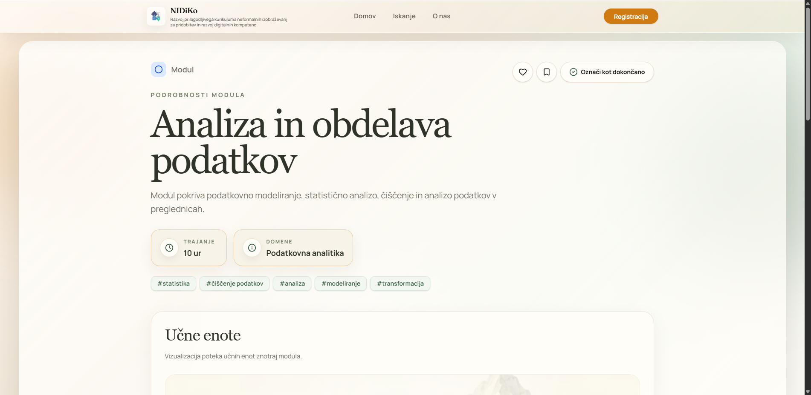 | 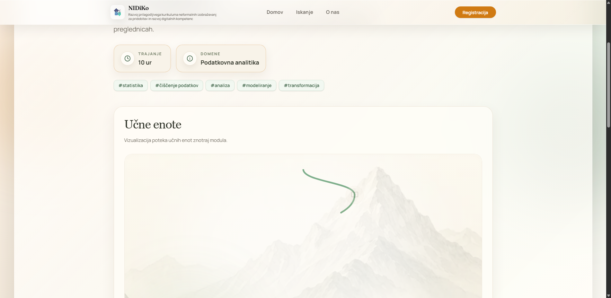 |

| Korak 4.3: Podrobnosti učne enote ue_036 |
|---|
| 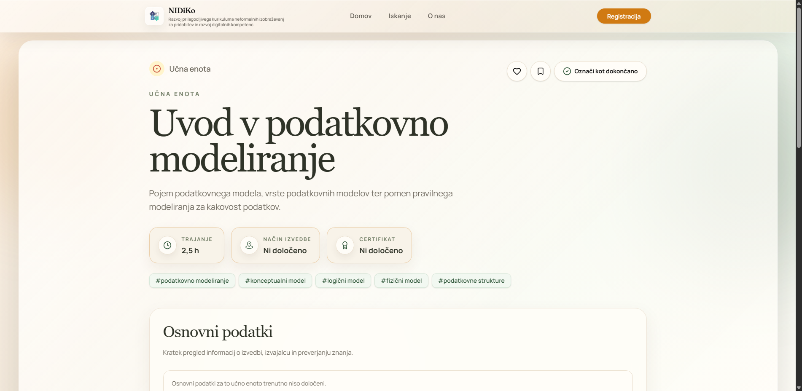 |

---

### 5.5 Testni scenarij 5 (TS-NIDIKO-05): Diagnostično samoocenjevanje na ravni posameznega modula

#### 5.5.1 Specifikacija scenarija po ISO/IEC/IEEE 29119-3:2021

| Parameter | Vrednost |
|---|---|
| **Identifikator scenarija** | `TS-NIDIKO-05` |
| **Naziv scenarija** | Diagnostično samoocenjevanje na ravni posameznega modula (Module Assessment) |
| **Odgovorna oseba** | **Mihajlo Dejanović** |
| **Cilj testiranja** | Preveriti inicializacijo samoocenjevalnega vprašalnika neposredno na ravni modula (`target_type=module`), preveriti pravilen zajem odgovorov, zaključitev vprašalnika ter vrnitev uporabnika na podrobnosti modula z zabeleženim stanjem. |
| **Sledljivost zahtev** | KF-03 (Vprašalnik), KF-04 (Priporočilni sistem na ravni modula), Uporabniški tok 9 |
| **Predpogoji** | Modul `mod_014` vsebuje pripravljena vprašanja za povezane učne enote. |
| **Testni podatki** | Cilj: `target_type=module`, `target_id=mod_014`; Odgovor: `"Da"` na vprašanje o podatkovnem modeliranju |
| **Končni status** | **USPEŠNO (PASS)** – 3/3 korakov uspešnih (11.64 s) |

#### 5.5.2 Zapisnik izvedenih korakov in primerjava rezultatov

| # | Uporabniška akcija | Vhodni podatki | Pričakovani rezultat | Dejanski rezultat | Čas | Status | Posnetek zaslona |
|:---:|---|---|---|---|:---:|:---:|---|
| **5.1** | Zagon vprašalnika za modul `mod_014` | URL: `http://46.225.17.135/assessment?target_type=module&target_id=mod_014` | Naloži se vprašalnik s specifičnimi vprašanji za modul »Analiza in obdelava podatkov«. | Naloženo vprašanje: *»Razumem, kaj je podatkovni model in zakaj ga potrebujemo.«*. | 2.79 s | **PASS** | `assets/funkcionalno-testiranje/ts05_01_modul_vprasalnik_zacetek.png` |
| **5.2** | Izbira odgovora »Da« na ravni modula | Klik na gumb `"Da"` | Izbira se označi, aktivira se navigacijski gumb *»Naslednjo →«*. | Odgovor zabeležen, aktiven gumb *»Naslednjo →«*. | 1.47 s | **PASS** | `assets/funkcionalno-testiranje/ts05_02_modul_vprasalnik_da.png` |
| **5.3** | Zaključek vprašalnika in oddaja odgovorov | Klik na gumb *»Zaključi →«* | Zaledna obdelava odgovorov in uspešna preusmeritev nazaj na stran podrobnosti modula. | Uspešna oddaja in preusmeritev na `http://46.225.17.135/modules/mod_014`. | 7.38 s | **PASS** | `assets/funkcionalno-testiranje/ts05_03_modul_ocena_rezultat.png` |

#### 5.5.3 Slikovni dokazi izvedbe (Scenarij 5)

| Korak 5.1: Začetek vprašalnika modula | Korak 5.2: Odgovor Da na modulu |
|---|---|
| 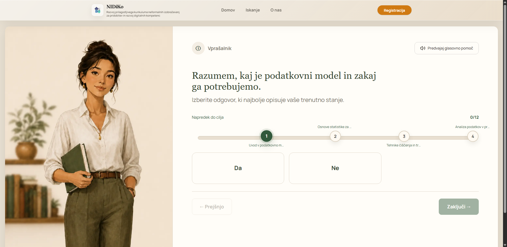 |  |

| Korak 5.3: Stanje po oddaji ocenjevanja modula |
|---|
|  |

---

### 5.6 Testni scenarij 6 (TS-NIDIKO-06): Pregled predstavitvene vsebine »O nas«, delovanje navigacije in odzivni dizajn

#### 5.6.1 Specifikacija scenarija po ISO/IEC/IEEE 29119-3:2021

| Parameter | Vrednost |
|---|---|
| **Identifikator scenarija** | `TS-NIDIKO-06` |
| **Naziv scenarija** | Pregled predstavitvene vsebine »O nas«, delovanje navigacije in odzivni dizajn |
| **Odgovorna oseba** | **Mihajlo Dejanović** |
| **Cilj testiranja** | Preveriti dostopnost in pravilnost prikaza informativne strani »O nas« (`/about`), preizkusiti delovanje krovnih navigacijskih povezav v glavi ter empirično preveriti odzivni dizajn (odzivnost postavitve ob spremembi velikosti okna brskalnika na mobilno ločljivost 375×812). |
| **Sledljivost zahtev** | KF-06 (Uporabniška izkušnja in odzivnost), Uporabniški tokovi 1 in 2 |
| **Predpogoji** | Aplikacija NIDiKo je zagnana in dosegljiva v spletnem brskalniku. |
| **Testni podatki** | Namizna ločljivost: 1920×1080; Mobilna ločljivost: 375×812 (iPhone X/12 viewport) |
| **Končni status** | **USPEŠNO (PASS)** – 3/3 korakov uspešnih (5.70 s) |

#### 5.6.2 Zapisnik izvedenih korakov in primerjava rezultatov

| # | Uporabniška akcija | Vhodni podatki | Pričakovani rezultat | Dejanski rezultat | Čas | Status | Posnetek zaslona |
|:---:|---|---|---|---|:---:|:---:|---|
| **6.1** | Navigacija na stran »O nas« v namiznem pogledu | URL: `http://46.225.17.135/about` (1920×1080) | Prikaz vizije projekta, predstavitve rešitve in povezave z okvirom DigComp. | Stran naložena, naslov: *»Prilagodljiv razvoj digitalnih kompetenc.«*. | 2.41 s | **PASS** | `assets/funkcionalno-testiranje/ts06_01_o_nas_namizje.png` |
| **6.2** | Preverjanje krovne navigacije v glavi strani | Elementi `<nav>` in `<header>` | Prikazane delujoče povezave: Domov, Iskanje, O nas ter Registracija/Prijava. | Zaznanih 9 navigacijskih povezav, vse povezave veljavne. | 0.29 s | **PASS** | `assets/funkcionalno-testiranje/ts06_02_navigacija_glava.png` |
| **6.3** | Preizkus odzivnega prikaza na mobilni ločljivosti | Sprememba okna brskalnika na 375×812 | Elementi se prilagodijo manjšemu zaslonu brez vodoravnega zamika ali prekrivanja. | Odzivna postavitev potrjena, vsebina berljiva in prilagojena mobilnemu pogledu. | 3.00 s | **PASS** | `assets/funkcionalno-testiranje/ts06_03_o_nas_mobilni_pogled.png` |

#### 5.6.3 Slikovni dokazi izvedbe (Scenarij 6)

| Korak 6.1: Stran »O nas« (Namizje 1920×1080) | Korak 6.2: Glavna navigacija |
|---|---|
|  | 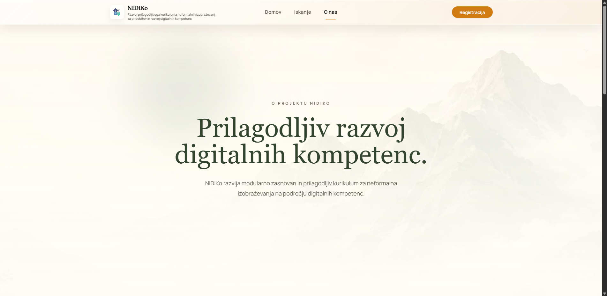 |

| Korak 6.3: Stran »O nas« v mobilnem pogledu (375×812) |
|---|
| 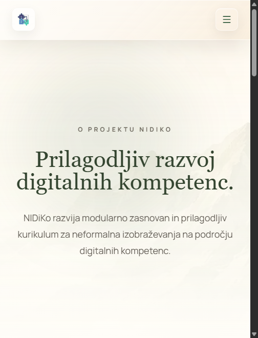 |

---

## 6. Tehnični postopek avtomatizirane izvedbe testov z brskalnikom

Avtomatizacija je bila izvedena z namenskim testnim poganjalnikom v Pythonu ([`backend/tests/functional/run_functional_tests.py`](../backend/tests/functional/run_functional_tests.py)), ki neposredno upravlja brskalnik Google Chrome prek Selenium WebDriverja:

```
        +-------------------------------------------------------------+
        |      Avtomatizirani testni skript (Python 3.13)             |
        |          backend/tests/functional/run_functional_tests.py  |
        +------------------------------+------------------------------+
                                       |
                                       v  (Selenium WebDriver / Chrome DevTools)
        +-------------------------------------------------------------+
        |               Google Chrome (Brezglavi način)               |
        |            Ločljivost: 1920x1080 & Mobilna 375x812          |
        +------------------------------+------------------------------+
                                       |
                       +---------------+---------------+
                       |                               |
                       v                               v
        +------------------------------+ +----------------------------+
        |   Sklop 1: Tilen Kek         | | Sklop 2: Mihajlo Dejanović |
        |   - TS-01: Iskanje in poti   | | - TS-04: Moduli in enote   |
        |   - TS-02: Vprašalnik učne p.| | - TS-05: Vprašalnik modula |
        |   - TS-03: Avtentikacija & AI| | - TS-06: O nas in odzivnost|
        +------------------------------+ +----------------------------+
                                       |
                                       v
        +-------------------------------------------------------------+
        |      Staging strežnik: http://46.225.17.135 (React + API)   |
        +-------------------------------------------------------------+
```

### Ključne tehnične rešitve v skripti:
1. **Preprečevanje absolutnih lokalnih poti:**  
   Vse poti za shranjevanje posnetkov in JSON poročila so definirane relativno glede na koren repozitorija (`docs/assets/funkcionalno-testiranje/`). Posledično koda in generirani JSON dokumenti delujejo identično na kateremkoli računalniku ali CI/CD strežniku.
2. **Ravnanje z asinhronimi stanji in animacijami:**  
   Uporabljeno je bilo kombinirano dinamično čakanje (`WebDriverWait`) ter JavaScript osredotočanje (`scrollIntoView({block: 'center'})`), kar zagotavlja visoko stabilnost brez lažnih napak zaradi animacij knjižnice *Framer Motion*.
3. **Avtomatski izvoz meritev v JSON:**  
   Ob vsakem zagonu se generira strojno berljiva datoteka [`docs/assets/funkcionalno-testiranje/test_execution_summary.json`](assets/funkcionalno-testiranje/test_execution_summary.json).

---

## 7. Zbirni rezultati testiranja, metrika in analiza odstopanj (Defect Log)

### 7.1 Zbirna statistika izvedenih testov

| Metrika | Vrednost | Opomba |
|---|:---:|---|
| **Število preizkušenih scenarijev** | **6** | 3 za Tilna Keka (TS-01 do TS-03) + 3 za Mihajla Dejanovića (TS-04 do TS-06) |
| **Skupno število izvedenih korakov** | **23** | Vsi koraki so bili neposredno izvedeni z brskalnikom Google Chrome |
| **Uspešno zaključenih korakov (PASS)** | **23** | **100 % stopnja uspešnosti** |
| **Neuspešnih korakov (FAIL)** | **0** | Ni bilo zrušitev, prekinitev ali napak |
| **Skupni čas izvajanja vseh 6 scenarijev** | **75.2 sekunde** | Vključno z zajemom 16 posnetkov zaslona in omrežnimi klici |
| **Povprečni čas izvedbe posameznega koraka** | **3.27 sekunde** | Hitra odzivnost spletnega odjemalca in zalednega FastAPI strežnika |

### 7.2 Analiza opažanj in priporočila za izboljšave (Observation & Defect Log)

1. **Opažanje 1 (UX prijava): Generično sporočilo o napaki**  
   - *Ugotovitev:* Ob napačnem geslu ali neobstoječem uporabniku prijavni obrazec prikaže splošno sporočilo *»Prišlo je do napake. Poskusite znova.«*.  
   - *Priporočilo:* Prikaz bolj specifičnega opozorila (npr. *»Napačno geslo ali neveljaven e-poštni naslov«*), kar izboljša uporabniško izkušnjo.
2. **Opažanje 2 (Dostopnost - A11y): Uporaba `<article>` namesto `<a>` pri karticah**  
   - *Ugotovitev:* Kartice zadetkov v iskalniku uporabljajo element `<article onClick={...}>`.  
   - *Priporočilo:* Za boljšo podporo bralnikom zaslona ter možnost odpiranja zadetkov v novem zavihku (srednji klik z miško) je priporočljivo kartice oviti v standardno povezavo `<a href="...">`.
3. **Pozitivna ugotovitev (Arhitekturna robustnost):**  
   - Logika predpogojev vprašalnika tako na ravni učne poti kot modula deluje brezhibno – ob odgovoru »Ne« sistem uporabniku nemudoma ponudi gumb *»Zaključi →«*, zaledni servis `/api/assessment/evaluate` pa v nekaj stotinkah sekunde vrne strukturirano priporočilo.

---

## 8. Sklep in priporočila za nadaljnje zagotavljanje kakovosti

Funkcionalno testiranje je potrdilo, da je rešitev **NIDiKo** stabilna, visoko odzivna in primerna za uporabo:
- Vseh **6 testnih scenarijev** (TS-NIDIKO-01 do TS-NIDIKO-06), ki sva jih pripravila **Tilen Kek** in **Mihajlo Dejanović**, je v celoti prestalo avtomatizirano verifikacijo v brskalniku Google Chrome s **100 % uspešnostjo**.
- Uporabniški tokovi iskanja, hierarhične navigacije skozi module in enote, diagnostičnega vprašalnika ter zaščite uporabniških funkcij delujejo skladno s specifikacijami.

### Priporočilo za CI/CD integracijo:
Predlagava, da se skripta `backend/tests/functional/run_functional_tests.py` doda kot opcijski korak v obstoječi GitHub Actions delotok ([`.github/workflows/ci.yml`](../.github/workflows/ci.yml)) za samodejno izvajanje ob vsakem *pull requestu*.

---

## 9. Izjava o uporabi orodij umetne inteligence (AI Declaration)

V skladu z navodili predmeta Zagotavljanje kakovosti izjavljava:

Pri analizi projektne dokumentacije, oblikovanju strukturiranih tabel testnih scenarijev po mednarodnem standardu **ISO/IEC/IEEE 29119-3:2021** ter pripravi Python skripte za Selenium WebDriver sva si pomagala z naprednimi orodji umetne inteligence (Google Antigravity / Gemini).

Vsi testni scenariji so bili v celoti empirično izvedeni z brskalnikom nad delujočo platformo NIDiKo, vsi rezultati, meritve in zajeti zaslonski posnetki pa so bili s strani obeh avtorjev (Tilen Kek, Mihajlo Dejanović) skrbno pregledani in verificirani.
