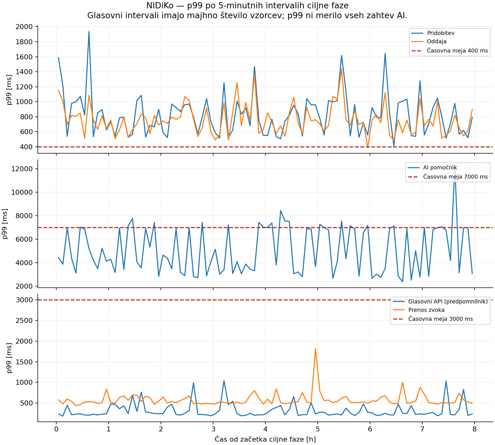
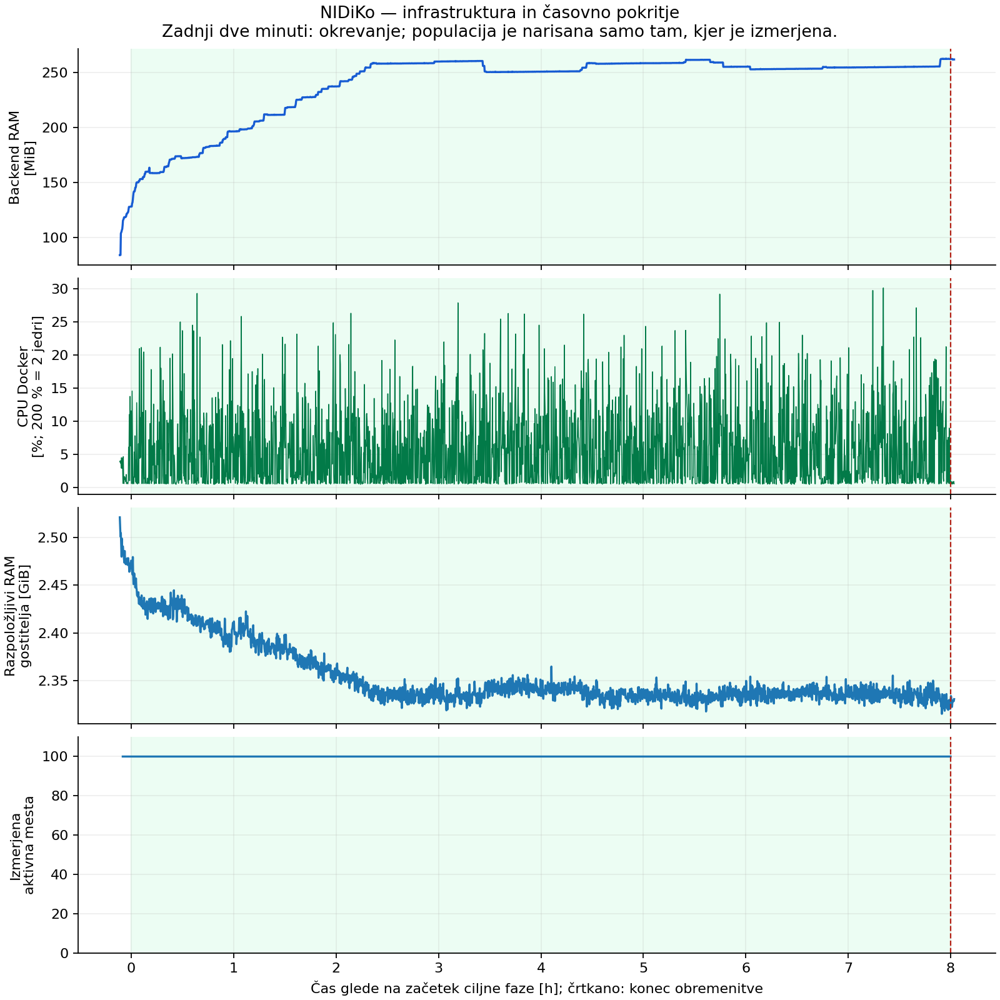

# Poročilo sistemskega testiranja NIDiKo

**Vzdržljivostni test, 2. 11. 2026 — zaključeno.** Ponovitev je izvedla osem ur ciljne obremenitve s 100 aktivnimi uporabniki. Tehnična uspešnost je presegla 99,9 %, vendar časovni kriteriji običajnih zahtev in AI niso bili v celoti doseženi. **Končna ocena: FAIL zaradi odzivnosti; izvedba ponovitve je veljavna glede trajanja in izmerjene populacije.**

## Namen, orodje in okolje

Preverjali smo stabilnost reševanja vprašalnika ob dolgotrajni mešani uporabi običajnih API-jev, besedilnega AI pomočnika in glasovne pomoči. Izbrali smo Locust 2.47.0: uporabniške poteke je mogoče zapisati v Pythonu, simulirati premore in rezultate ločiti po skupinah zahtev. To je vzdržljivostni test; največje zmogljivosti sistema nismo iskali.

| Podatek | Izvedena konfiguracija |
|---|---|
| Staging | CX23, 2 vCPU, približno 4 GB RAM; javni HTTP dostop |
| Aplikacija | Docker; FastAPI/Uvicorn, en proces; React frontend |
| Zunanje odvisnosti | MongoDB; Azure OpenAI, Speech in Blob Storage |
| Aplikacijski commit | `6853f9d77d04477745943885cc6c08e5dd5ab3e6` |
| Testni commit ob začetku | `9040255757f74cfaa8cc8840dd2442a7cbf66fde`; delovna kopija ob začetku čista |
| Generator | ločen Windows prenosnik, en proces Locusta |
| Vsebina | učna pot `up_001`, 14 vprašanj DA/NE |
| Izolacija | namenska baza `psi_up_staging_perf_retry_20261102`, 15.000 novih sintetičnih profilov |
| Glasovni predpomnilnik | 21 začetnih zapisov, kopiranih iz prve testne baze |

Staging je med testom uporabljal namensko bazo; prvotnih profilov iz `psi_up` nismo spreminjali. Namestitve so bile začasno zadržane z `STAGING_DEPLOY_PAUSED=true`. Generator ni porabljal virov CX23. Manifest, profil in podatkovni povzetek so v [dokazih izvedbe](assets/system-testing/20261102T131105Z/README.md).

## Scenarij in kriteriji pred izvedbo

Uporabnik pridobi vprašalnik, bere vprašanja s premori 15–35 s in na koncu odda vse odgovore za ocenjevanje. Po zaključenem poteku aktivno mesto dobi nov profil. Od 100 mest jih 40 uporablja AI pomočnika, pet od teh tudi enkrat na reševanje glasovno pomoč. Uporabnik AI pošlje 1–20 sporočil z uteženo porazdelitvijo, povprečno 4,06 načrtovanega sporočila na tak potek; po pomoči sledi dodatnih 10–25 s branja. Deleži veljajo za aktivna mesta, ne nujno za vse zaključene poteke. To so predpostavke, ne meritve dejanske uporabe.

Obremenitev smo povečevali za enega uporabnika na sekundo; po doseženih 100 mestih je sledilo pet minut ogrevanja, osem ur ciljne obremenitve in dve minuti opazovanja po odstranitvi obremenitve.

Kriteriji: vsaj 99,9 % tehnično uspešnih veljavnih odgovorov v vsaki skupini; pri pridobitvi in oddaji vprašalnika vsaj 99 % vseh zahtev uspešnih v največ 400 ms; **vse** zahteve AI uspešne v največ 7 s do celotnega odgovora. Pri pripravljeni glasovni pomoči sta bili postavljeni ločeni meji 3 s za API in 3 s za celoten prenos posnetka. Za prvo ustvarjanje glasu časovni prag ni bil določen. Pragov po meritvah nismo spreminjali. Podrobnosti so v [prvotnem načrtu](17-nacrt-sistemskega-testiranja.md).

## Izvedba in sledljivost

Vsi spodnji lokalni časi veljajo za Europe/Ljubljana, 2. 11. 2026 (UTC + 1).

| Izvedba | Identifikator | Potek in obravnava |
|---|---|---|
| Pilot | `20261102T103826Z` | 11:38:26–11:40:59; 20 mest, skrajšani premori, 120 s ciljne faze; preverjen celoten potek, FAIL zaradi časov |
| Prvi glavni zagon | `20261102T104244Z` | 11:42:44–14:05:40; približno 51-minutna in dodatna krajša vrzel generatorja, nato izklop prenosnika; INVALID, arhiviran ločeno |
| Ponovitev | `20261102T131105Z` | 14:11:05–22:19:47; ciljna faza **14:17:46–22:17:46**, natanko 28.800 s |

Ponovitve nismo združevali s prvim zagonom. Preverjanje dogodkov ponovitve potrjuje 100 mest v vseh vzorcih ciljne populacije; največji razmik med zaporednima vzorcema je 1,71 s. Razmik meritev generatorja je največ 10,15 s. Zaključni zapis, vse zahtevane skupine in celotno trajanje so prisotni, brez neveljavnih vrstic ali napak izvajanja scenarija. To potrjuje izmerjeno časovno pokritje; ne pomeni, da je vseh 100 mest vsak trenutek pošiljalo zahtevo.

## Rezultati

**Celoten zagon:** 26.865 zahtev, štiri neuspešne (vse pri AI), uspešnost **99,9851 %**. Začelo se je 7.750 reševanj, 7.650 jih je uspešno doseglo oddajo; 100 potekov je bilo ob odstranitvi obremenitve še aktivnih. Ti niso neuspešne oddaje. Uspešna oddaja tudi ne pomeni, da je vsa pomoč v poteku izpolnila svoje kriterije.

**Samo osemurna ciljna faza:** 26.583 zahtev, štiri neuspešne, uspešnost **99,9850 %**, povprečno 0,923 zahteve/s. Spodnja tabela uporablja izvorne čase te faze. Delež »v meji« šteje uspešne pravočasne zahteve med vsemi zahtevami skupine.

| Skupina | Zahteve | Napake | Uspešnost | Uspešne v časovni meji | p99 [ms] | Največ [ms] | Ocena |
|---|---:|---:|---:|---:|---:|---:|---|
| Pridobitev vprašalnika | 7.617 | 0 | 100 % | 92,02 % do 400 ms | 852,56 | 1.936,48 | FAIL |
| Oddaja in ocenjevanje | 7.617 | 0 | 100 % | 91,73 % do 400 ms | 725,80 | 1.438,04 | FAIL |
| AI pomočnik | 10.713 | 4 | 99,9627 % | 99,19 % do 7 s | 6.881,30 | 12.257,03 | FAIL |
| Pripravljen glasovni API | 318 | 0 | 100 % | 100 % do 3 s | 825,09 | 1.043,39 | PASS* |
| Celoten prenos zvoka | 318 | 0 | 100 % | 100 % do 3 s | 841,90 | 1.819,72 | PASS* |

\* Glasovni skupini imata manj kot 1.000 vzorcev; rezultat opisuje opažene zahteve in ne dokazuje dolgoročne 99,9-odstotne zanesljivosti. V ponovitvi so bili vsi glasovni API odgovori iz predpomnilnika; prvo ustvarjanje je bilo opaženo v pilotu, ne obremenjeno v glavnem testu.

Kriterij tehnične uspešnosti 99,9 % je izpolnjen v vsaki skupini. Pri AI je 83 uspešnih odgovorov preseglo 7 s, štiri dodatne zahteve pa niso dobile veljavnega odgovora HTTP (`HTTP 0` v testnem dnevniku). To niso štirje odgovori s statusno kodo HTTP 0. Vzrok iz ohranjenih podatkov ni dokazan. AI p99 je pod 7 s, vendar je bil dogovorjeni kriterij meja za **vse** zahteve, zato AI dobi FAIL.

Izpis Locusta zajema tudi ogrevanje in prehod ter prikazuje približne percentile. Zato se njegovih 26.865 zahtev in približnih p99 ne sme zamenjati z natančnimi rezultati 26.583 zahtev ciljne faze. Ta razlika ni izločanje napak: vse štiri napake so vključene v ciljno statistiko.

## Infrastruktura in okrevanje

V 2.377 vzorcih stanja je bil backend isti vsebnik in v stanju `running`; ponovnega zagona med merjenjem nismo opazili. Docker CPU je v ciljni fazi povprečno znašal 5,78 %, največ 30,12 % (na dveh jedrih lahko doseže 200 %). Gostitelj je imel najmanj 2,31 GiB razpoložljivega RAM in približno 6,96 GiB prostega diska. Ti podatki ne kažejo nasičenja CPU ali izčrpanja RAM.

Backend RAM je v ciljni fazi znašal 127,9–262,7 MiB. Povprečje prvih desetih minut je bilo 149,9 MiB, zadnjih desetih 259,8 MiB. Rast se je po približno 2,5 ure večinoma ustalila okoli 250–263 MiB. Po dveh minutah brez obremenitve je ostalo približno 261,9 MiB. Iz tega ne sklepamo niti o dokazanem puščanju pomnilnika niti o povrnitvi na izhodišče. Za presojo so potrebni profiliranje in daljše opazovanje; numerični kriterij za RAM ni bil določen.

Generator je imel povprečno 4,85 % sistemske porabe CPU in največ 29,4 %; tudi ta meritev ne kaže trajnega CPU nasičenja generatorja. Metrike MongoDB in Azure kvot niso bile vključene, zato vzroka počasnejših zahtev ali napak ni mogoče zanesljivo določiti.

## Obnova, dokazi in omejitve

Nadzornik je ob **22:20:02** potrdil prenos infrastrukturnih meritev, obnovo prvotne konfiguracije in baze `psi_up` ter odstranitev premora CI/CD. Naknadno preverjanje je potrdilo isto bazo in odsotnost zbiralnika v `tmux`. Obnovitev vsebnika po testu je ločen dogodek od merjene stabilnosti med testom.

Celotni dokazi vseh izvedb so arhivirani ločeno od zgodovine Git. V repozitoriju so izbrani grafi, manifest, profil, časovne statistike, kontrolne vsote in [kazalo dokazov](assets/system-testing/20261102T131105Z/README.md). Datoteke ne vsebujejo poverilnic, evidenc uporabniških profilov ali podpisanih zvočnih povezav. Navodila za ponovitev so v [testnem sklopu](../tests/performance/README.md).

Po arhiviranju je bilo po treh evidencah odstranjenih 35.000 sintetičnih profilov in njihove AI seje/sporočila; preverjanje je za vse tri sklope vrnilo nič preostalih profilov. Prvotnih uporabnikov je pred čiščenjem in po njem ostalo 29. Učne zbirke testnih baz in skupni Azure posnetki so ohranjeni.

Test pokriva API potek in prenos posnetka, ne izrisa strani, časa od klika do začetka predvajanja, registracije/prijave Supabase ali prihodnjih funkcij mikropotrdil. Sintetični profili niso računi Supabase. Preizkušena je ena učna pot s predpostavljenimi premori in deleži; rezultat ni splošna garancija univerzitetne uporabe ali največjega števila uporabnikov.

## Sklep in drugi del skupne naloge

Postavitev je v izmerjeni ponovitvi vzdrževala 100 aktivnih mest osem ur z visoko tehnično uspešnostjo, vendar **ne izpolnjuje vseh vnaprej določenih časovnih zahtev**. Pred spreminjanjem infrastrukture priporočamo merjenje trajanja podatkovnih poizvedb in posameznih korakov oddaje, razvrstitev napak povezave ter profiliranje rasti pomnilnika. Morebitne izboljšave je treba potrditi z novo primerjalno meritvijo.

Drugi član ekipe mora svoj **stresni test** dodati ločeno: avtor, scenarij, kriteriji, dejanske stopnje, rezultati, okrevanje in dokazi (pripravljen je [načrt stresnega testiranja](19-nacrt-stresnega-testiranja.md) ter testni sklop). Zunanji zagon na stagingu še ni izveden in ga to poročilo ne nadomešča. Skupni sklep obeh članov se dopolni šele po njegovi izvedbi; del vzdržljivostnega testiranja je zaključen.
